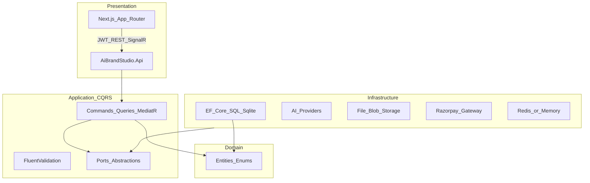

# Architecture — AI Brand Identity Studio

## Clean Architecture



## Backend projects
| Project | Responsibility |
| --- | --- |
| `AiBrandStudio.Domain` | Entities only |
| `AiBrandStudio.Application` | Use cases, DTOs, interfaces, validators |
| `AiBrandStudio.Infrastructure` | EF, JWT, AI, storage, payments, seed |
| `AiBrandStudio.Api` | Controllers, SignalR, Swagger, middleware |
| `AiBrandStudio.Tests` | Unit tests |

## Frontend structure
```
frontend/src/
  app/           # routes (dashboard, wizard, generators, admin...)
  components/    # reusable AppShell, GeneratorStudio, BrandPicker, UpgradeBanner
  lib/           # api client, redux store
```

## Security layers
1. Transport HTTPS (Azure)
2. JWT access + refresh rotation
3. RBAC (`[Authorize(Roles="Admin")]`)
4. Rate limit auth endpoints
5. Credit gate before costly AI ops
6. Ownership checks on project/brand queries

## Scalability path
- Stateless API → scale-out on App Service / AKS
- Redis distributed cache / SignalR backplane
- Blob storage for assets
- Queue (Phase 2) for long AI jobs
