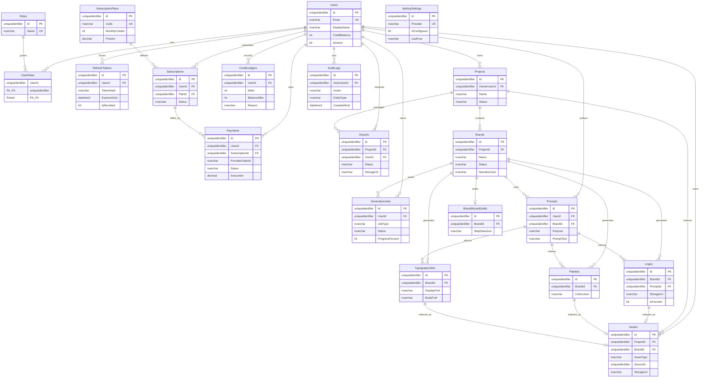

# Database Design — AI Brand Identity Studio

**Phase:** 1 MVP  
**Engine:** Microsoft SQL Server 2022  
**ORM:** Entity Framework Core (`net10.0`)

---

## 1. Design principles

- **UUID (`uniqueidentifier`)** primary keys for all domain tables (client-safe ids).  
- **Soft delete** via `IsDeleted` + `DeletedAtUtc` on user-owned content.  
- **Audit columns** `CreatedAtUtc`, `UpdatedAtUtc` on mutable entities.  
- **Credits** are append-only in `CreditLedgers` (balance derived or cached on `Users`).  
- **Binary blobs** live in storage; tables hold URI + metadata only.  
- **Prompts** retained for reproducibility, support, and cost analysis.

---

## 2. Table list

| Table | Purpose |
| --- | --- |
| `Users` | Accounts, profile, cached credit balance |
| `Roles` | Role catalog (`User`, `Admin`) |
| `UserRoles` | Many-to-many user ↔ role |
| `RefreshTokens` | Rotating refresh tokens |
| `Projects` | User workspaces / brand containers |
| `Brands` | Brand identity records from wizard |
| `BrandWizardDrafts` | Incomplete wizard state (JSON) |
| `Logos` | Generated logo assets |
| `Palettes` | Generated color systems |
| `TypographySets` | Font pairing suggestions |
| `Assets` | Unified asset library index |
| `Prompts` | Prompt text + provider metadata |
| `GenerationJobs` | Async job status for SignalR |
| `CreditLedgers` | Append-only credit movements |
| `SubscriptionPlans` | Plan catalog |
| `Subscriptions` | User ↔ plan binding |
| `Payments` | Razorpay/order payment records |
| `Exports` | ZIP export jobs & URIs |
| `AuditLogs` | Security and admin trail |
| `ApiKeySettings` | Provider key references (encrypted/masked display) |

---

## 3. Relationships (logical)

```
Users 1──* Projects
Users 1──* CreditLedgers
Users 1──* Subscriptions
Users 1──* RefreshTokens
Users *──* Roles (via UserRoles)

Projects 1──* Brands
Projects 1──* Assets
Projects 1──* Exports

Brands 1──* Logos
Brands 1──* Palettes
Brands 1──* TypographySets
Brands 1──0..1 BrandWizardDrafts
Brands *──* Prompts (via PromptId FK on generation rows)

Assets 0..1── Logo | Palette | Typography | BrandDoc (polymorphic via AssetType + SourceId)

SubscriptionPlans 1──* Subscriptions
Subscriptions 1──* Payments

GenerationJobs → Users, Brands (optional), Projects
AuditLogs → Users (actor)
```

---

## 4. Column sketches

### Users

| Column | Type | Notes |
| --- | --- | --- |
| Id | uniqueidentifier PK | |
| Email | nvarchar(320) UK | Normalized |
| PasswordHash | nvarchar(max) | Identity hash |
| DisplayName | nvarchar(200) | |
| CreditBalance | int | Cached; ≥ 0 |
| IsActive | bit | |
| CreatedAtUtc / UpdatedAtUtc | datetime2 | |
| IsDeleted / DeletedAtUtc | bit / datetime2 null | |

### Roles / UserRoles

| Roles | UserRoles |
| --- | --- |
| Id, Name (UK), Description | UserId FK, RoleId FK, composite PK |

### Projects

| Column | Type | Notes |
| --- | --- | --- |
| Id | uniqueidentifier PK | |
| OwnerUserId | uniqueidentifier FK → Users | |
| Name | nvarchar(200) | |
| Description | nvarchar(1000) null | |
| Status | nvarchar(50) | Active / Archived |
| CreatedAtUtc / UpdatedAtUtc | datetime2 | |
| IsDeleted / DeletedAtUtc | | |

### Brands

| Column | Type | Notes |
| --- | --- | --- |
| Id | uniqueidentifier PK | |
| ProjectId | uniqueidentifier FK | |
| Name | nvarchar(200) | |
| Industry | nvarchar(120) | |
| Audience | nvarchar(500) | |
| Tone | nvarchar(200) | |
| NarrativeJson | nvarchar(max) | Taglines, voice, positioning |
| Status | nvarchar(50) | Draft / Generated / Final |
| PrimaryLogoId | uniqueidentifier null | |
| PrimaryPaletteId | uniqueidentifier null | |
| PrimaryTypographyId | uniqueidentifier null | |

### Logos

| Column | Type | Notes |
| --- | --- | --- |
| Id | uniqueidentifier PK | |
| BrandId | FK | |
| PromptId | FK null | |
| Provider | nvarchar(50) | Ideogram / Mock |
| StorageUri | nvarchar(1000) | |
| ThumbnailUri | nvarchar(1000) null | |
| StyleTags | nvarchar(500) null | |
| IsFavorite | bit | |
| GenerationJobId | uniqueidentifier null | |

### Palettes

| Column | Type | Notes |
| --- | --- | --- |
| Id | uniqueidentifier PK | |
| BrandId | FK | |
| PromptId | FK null | |
| ColorsJson | nvarchar(max) | Hex roles |
| CssExport | nvarchar(max) null | Cached |
| ContrastNotes | nvarchar(max) null | |

### TypographySets

| Column | Type | Notes |
| --- | --- | --- |
| Id | uniqueidentifier PK | |
| BrandId | FK | |
| PromptId | FK null | |
| DisplayFont | nvarchar(120) | |
| BodyFont | nvarchar(120) | |
| MonoFont | nvarchar(120) null | |
| GuidanceJson | nvarchar(max) | Weights, pairings |

### Assets

| Column | Type | Notes |
| --- | --- | --- |
| Id | uniqueidentifier PK | |
| ProjectId | FK | |
| BrandId | FK null | |
| OwnerUserId | FK | |
| AssetType | nvarchar(50) | Logo / Palette / Typography / BrandDoc / Export |
| SourceId | uniqueidentifier | Points to Logos/Palettes/… |
| Name | nvarchar(200) | |
| MimeType | nvarchar(100) null | |
| StorageUri | nvarchar(1000) | |
| ByteSize | bigint null | |
| IsFavorite | bit | |
| IsDeleted | bit | |

### Prompts

| Column | Type | Notes |
| --- | --- | --- |
| Id | uniqueidentifier PK | |
| UserId | FK | |
| BrandId | FK null | |
| Purpose | nvarchar(50) | Brand / Logo / Palette / Typography |
| Provider | nvarchar(50) | |
| Model | nvarchar(100) null | |
| PromptText | nvarchar(max) | |
| ResponseMetaJson | nvarchar(max) null | Tokens, latency |
| CreatedAtUtc | datetime2 | |

### CreditLedgers

| Column | Type | Notes |
| --- | --- | --- |
| Id | uniqueidentifier PK | |
| UserId | FK | |
| Delta | int | +bonus / −usage |
| BalanceAfter | int | |
| Reason | nvarchar(200) | SignupBonus, LogoGenerate, AdminGrant… |
| ReferenceType | nvarchar(50) null | |
| ReferenceId | uniqueidentifier null | |
| CreatedAtUtc | datetime2 | |
| CreatedByUserId | uniqueidentifier null | Admin actor |

### SubscriptionPlans

| Column | Type | Notes |
| --- | --- | --- |
| Id | uniqueidentifier PK | |
| Code | nvarchar(50) UK | FREE, PRO, AGENCY |
| Name | nvarchar(100) | |
| MonthlyCredits | int | |
| PriceInr | decimal(18,2) | |
| IsActive | bit | |
| FeaturesJson | nvarchar(max) | |

### Subscriptions

| Column | Type | Notes |
| --- | --- | --- |
| Id | uniqueidentifier PK | |
| UserId | FK | |
| PlanId | FK | |
| Status | nvarchar(50) | Active / PastDue / Canceled |
| CurrentPeriodStart / End | datetime2 | |
| ExternalCustomerId | nvarchar(100) null | |

### Payments

| Column | Type | Notes |
| --- | --- | --- |
| Id | uniqueidentifier PK | |
| UserId | FK | |
| SubscriptionId | FK null | |
| Provider | nvarchar(50) | Razorpay |
| ProviderOrderId | nvarchar(100) | |
| ProviderPaymentId | nvarchar(100) null | |
| AmountInr | decimal(18,2) | |
| Currency | nvarchar(10) | INR |
| Status | nvarchar(50) | Created / Paid / Failed |
| RawPayloadJson | nvarchar(max) null | |
| CreatedAtUtc | datetime2 | |

### Exports

| Column | Type | Notes |
| --- | --- | --- |
| Id | uniqueidentifier PK | |
| ProjectId | FK | |
| BrandId | FK null | |
| UserId | FK | |
| Status | nvarchar(50) | Pending / Ready / Failed |
| StorageUri | nvarchar(1000) null | |
| IncludedAssetIdsJson | nvarchar(max) | |
| ErrorMessage | nvarchar(1000) null | |
| CreatedAtUtc / CompletedAtUtc | datetime2 | |

### GenerationJobs

| Column | Type | Notes |
| --- | --- | --- |
| Id | uniqueidentifier PK | |
| UserId | FK | |
| ProjectId / BrandId | FK null | |
| JobType | nvarchar(50) | Brand / Logo / Palette / Typography / Export |
| Status | nvarchar(50) | Queued / Running / Succeeded / Failed |
| ProgressPercent | int | 0–100 |
| Message | nvarchar(500) null | |
| ResultJson | nvarchar(max) null | |
| CreatedAtUtc / UpdatedAtUtc | datetime2 | |

### AuditLogs

| Column | Type | Notes |
| --- | --- | --- |
| Id | uniqueidentifier PK | |
| ActorUserId | uniqueidentifier null | |
| Action | nvarchar(100) | |
| EntityType | nvarchar(100) null | |
| EntityId | uniqueidentifier null | |
| IpAddress | nvarchar(64) null | |
| DetailJson | nvarchar(max) null | |
| CreatedAtUtc | datetime2 | |

### ApiKeySettings

| Column | Type | Notes |
| --- | --- | --- |
| Id | uniqueidentifier PK | |
| Provider | nvarchar(50) UK | OpenAI / Gemini / Ideogram / Razorpay |
| IsConfigured | bit | Derived from env or encrypted value present |
| LastFour | nvarchar(4) null | For admin UI mask |
| UpdatedAtUtc | datetime2 | |
| UpdatedByUserId | uniqueidentifier null | |

> Phase 1 may source keys purely from environment and only persist **status + last four** for admin display—never store raw secrets in SQL if Key Vault/env is used.

---

## 5. Mermaid ER diagram



---

## 6. Indexes (recommended)

| Table | Index |
| --- | --- |
| Users | UX_Users_Email |
| Projects | IX_Projects_OwnerUserId |
| Brands | IX_Brands_ProjectId |
| Logos | IX_Logos_BrandId |
| Palettes | IX_Palettes_BrandId |
| Assets | IX_Assets_ProjectId_AssetType |
| CreditLedgers | IX_CreditLedgers_UserId_CreatedAtUtc |
| GenerationJobs | IX_GenerationJobs_UserId_Status |
| AuditLogs | IX_AuditLogs_CreatedAtUtc |
| Payments | UX_Payments_ProviderOrderId |
| RefreshTokens | IX_RefreshTokens_UserId |

---

## 7. Seed data (Phase 1)

- Roles: `User`, `Admin`  
- Plans: `FREE` (signup bonus only), `PRO`, `AGENCY` with credit allotments  
- Optional admin user via secure seed script (password from secret, not committed)  

See `/database` scripts for DDL and seed when implemented.

---

## 8. Migrations

- EF Core migrations live under `AiBrandStudio.Infrastructure`.  
- Apply on startup in Development; use controlled pipeline migration in Azure (see `cicd.md` / `deployment.md`).
