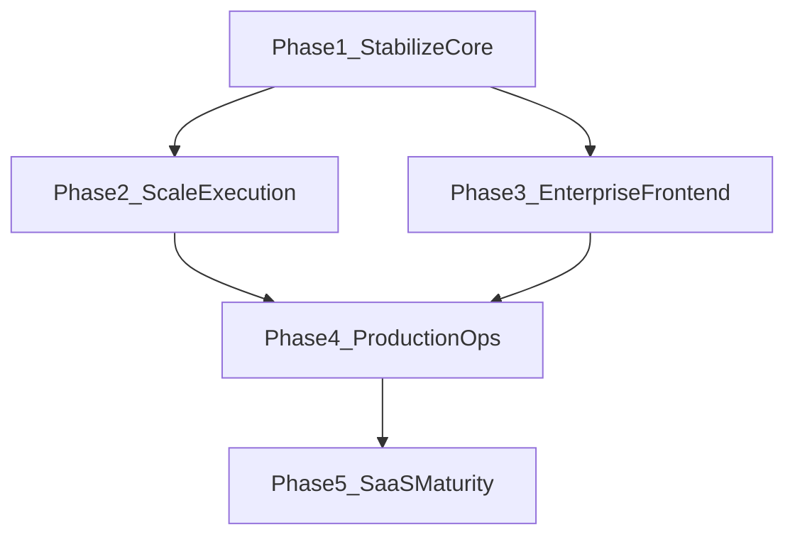

# Large-Scale Development Roadmap

**Product:** AI Brand Identity Studio  
**Last updated:** 2026-08-08  
**Owner (default):** Platform Engineering  

This roadmap sequences work from core correctness through SaaS maturity. Each phase has an exit gate; do not start the next phase until the current gate is met unless a documented exception is approved.

| Phase | Focus               | Status                |
| ----- | ------------------- | --------------------- |
| 1     | Stabilize core      | **Done** (2026-08-08) |
| 2     | Scale execution     | **Done** (2026-08-08) |
| 3     | Enterprise frontend | **Done** (2026-08-08) |
| 4     | Production ops      | **Done** (2026-08-08) |
| 5     | SaaS maturity       | **Done** (2026-08-08) |

---

## Phase 1 — Stabilize core

**Owner:** Backend  
**Goal:** Correct money, credits, schema evolution, storage access, and failure surfaces.

| Work item                 | Status | Notes                                                                                                         |
| ------------------------- | ------ | ------------------------------------------------------------------------------------------------------------- |
| EF migrations             | Done   | `Database.MigrateAsync` + `Persistence/Migrations/InitialCreate`; wipe legacy `EnsureCreated` SQLite DBs once |
| Atomic credit debit       | Done   | Debit-before-work + refund-on-failure; conditional balance update                                             |
| Protected storage         | Done   | JWT / short-lived `dt` tokens; no public `/storage` mount                                                     |
| Real payment verification | Done   | Razorpay order by `planCode`, webhook HMAC, idempotent credit grant + subscription                            |
| Global exception handling | Done   | ProblemDetails middleware (incl. 503 payments / 400 signature)                                                |

### Exit criteria (met)

- [x] API starts with migrations + seed; no production `EnsureCreated`
- [x] Concurrent overspend cannot drive balance negative; failed AI paths refund
- [x] Unconfigured Razorpay → 503; verified webhook capture grants credits once
- [x] Assets served only through authenticated download paths
- [x] Credit/payment unit tests green

---

## Phase 2 — Scale execution

**Owner:** Backend + Platform  
**Goal:** Long-running AI work and multi-instance deployment without sticky sessions or local disk.

| Work item             | Status | Target                                                                                       |
| --------------------- | ------ | -------------------------------------------------------------------------------------------- |
| Background job queue  | Done   | DB-backed `GenerationJob` + channel worker; logo/mockup/export enqueue; `GET /api/jobs/{id}` |
| Azure Blob storage    | Done   | `AzureBlobFileStorage` when `Storage:Provider=AzureBlob`                                     |
| AI retries / timeouts | Done   | Named HttpClients + `AddStandardResilienceHandler` (openai/gemini/ideogram)                  |
| SignalR user groups   | Done   | `Clients.User` + `user:{id}` groups; FE `@microsoft/signalr`                                 |
| Redis backplane       | Done   | `AddStackExchangeRedis` when `ConnectionStrings:Redis` set                                   |

### Exit criteria

- [x] Logo/mockup/export jobs survive API recycle; status queryable
- [x] Assets readable from Blob in non-local environments (`Storage:Provider=AzureBlob`)
- [x] AI provider calls have timeout + bounded retry; no unbounded hangs
- [x] Multi-instance SignalR delivers only to the owning user
- [x] Load test: 2 API replicas + Redis backplane pass smoke generation notify (ops drill) — see [ops-drill-replicas.md](ops-drill-replicas.md)

**Depends on:** Phase 1 complete.

---

## Phase 3 — Enterprise frontend

**Owner:** Frontend  
**Goal:** Maintainable Next.js surface with typed contracts and predictable auth UX.

| Work item                  | Status | Target                                                        |
| -------------------------- | ------ | ------------------------------------------------------------- |
| Feature folders            | Done   | `features/{auth,projects,generators}` with forms/hooks/studio |
| UI component library       | Done   | `components/ui` — button, field, dialog, alert                |
| Route guards               | Done   | `middleware.ts` cookie session + admin role gate              |
| Typed API modules          | Done   | `lib/api/{client,auth,projects,payments,generators,jobs}`     |
| Error / loading boundaries | Done   | Root + dashboard/wizard/admin `error.tsx` / `loading.tsx`     |

### Exit criteria

- [x] Auth-required routes blocked before paint (middleware)
- [x] Generators share one studio pattern; no duplicated fetch/error UI
- [x] Hand-typed API modules cover auth, projects, payments, generators, jobs
- [x] Segment error boundaries show recoverable UX (retry / billing CTA)
- [x] Lighthouse a11y on dashboard + wizard passes agreed baseline (manual QA) — see [qa-a11y.md](qa-a11y.md) (score >= 90)

**Depends on:** Phase 1 APIs stable; can overlap late Phase 2.

---

## Phase 4 — Production ops

**Owner:** DevOps + Platform  
**Goal:** Observable, deployable, recoverable production.

| Work item                    | Status | Target                                                                       |
| ---------------------------- | ------ | ---------------------------------------------------------------------------- |
| OpenTelemetry / App Insights | Done   | `AddObservability`; Azure Monitor when connection string set; console in dev |
| Sentry                       | Done   | API `Sentry:Dsn`; FE `@sentry/nextjs` when `NEXT_PUBLIC_SENTRY_DSN` set      |
| IaC                          | Done   | `infra/main.bicep` — App Service, SQL, Redis, Blob, App Insights             |
| GitHub deploy workflows      | Done   | `deploy-staging.yml`, `deploy-prod.yml` + smoke gate                         |
| Smoke / e2e gates            | Done   | `scripts/smoke.sh`/`.ps1` in CI; Playwright `frontend/e2e`                   |
| Backups                      | Done   | `docs/backups.md` + `docs/ops-runbook.md`                                    |

### Exit criteria

- [x] Staging deploy from main is one workflow (`deploy-staging.yml`)
- [x] Traces/metrics/logs correlate by `traceId` in ProblemDetails / health
- [x] Smoke + e2e gates in CI; prod workflow runs smoke after deploy
- [x] Documented RPO/RTO and restore drill (`docs/backups.md`)
- [x] On-call runbook (`docs/ops-runbook.md`)

**Depends on:** Phase 2 storage/queue choices locked.

---

## Phase 5 — SaaS maturity

**Owner:** Product + Backend  
**Goal:** Multi-tenant commercial controls and compliance posture.

| Work item               | Status | Target                                                                                  |
| ----------------------- | ------ | --------------------------------------------------------------------------------------- |
| Organizations / tenants | Done   | `Organization` + members; projects scoped by `OrganizationId`; personal org on register |
| Subscription lifecycle  | Done   | Trial → Active → PastDue → Canceled; cancel/renew APIs; dunning worker                  |
| Audit logging           | Done   | `IAuditService` writes on grants/payments/org/consent; `GET /api/admin/audit`           |
| Admin reports           | Done   | `GET /api/admin/reports/monthly?year=&month=` CSV                                       |
| Compliance controls     | Done   | Consent flags; `GET /api/account/export`; delete-request; `docs/compliance.md` DPA      |

### Exit criteria

- [x] User belongs to org; assets/credits scoped by tenant policy
- [x] Subscription states: trial → active → past_due → canceled
- [x] Immutable audit trail for admin credit grants and plan changes
- [x] Monthly admin report export (CSV) for finance
- [x] Account data export + delete request path documented and implemented

**Depends on:** Phase 1 payments + Phase 4 observability for trust/compliance evidence.

---

## Sequencing diagram

---

## Suggested milestones

| Milestone | Target outcome                                                   |
| --------- | ---------------------------------------------------------------- |
| M1        | Phase 1 exit (shipped)                                           |
| M2        | Queue + Blob + SignalR groups in staging                         |
| M3        | Frontend middleware + feature folders on main generators         |
| M4        | Staging auto-deploy + App Insights + smoke gate                  |
| M5        | Org tenancy + subscription cancel/renew + audit writes (shipped) |

---

## Related docs

- [ENTERPRISE-SPEC.md](ENTERPRISE-SPEC.md) — product formula and compliance matrix  
- [architecture.md](architecture.md) — Clean Architecture and scale notes  
- [deployment.md](deployment.md) — Docker / Azure  
- [cicd.md](cicd.md) — pipeline guidance  
- [testing-strategy.md](testing-strategy.md) — quality bar  
- [api.md](api.md) — REST contracts (payments §10)  
- [ops-drill-replicas.md](ops-drill-replicas.md) — 2-replica Redis SignalR drill  
- [qa-a11y.md](qa-a11y.md) — Lighthouse a11y baseline  
- [compliance.md](compliance.md) — export / delete / DPA

